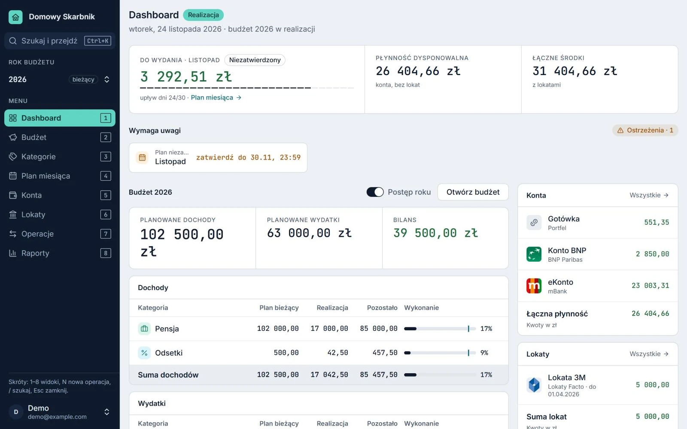
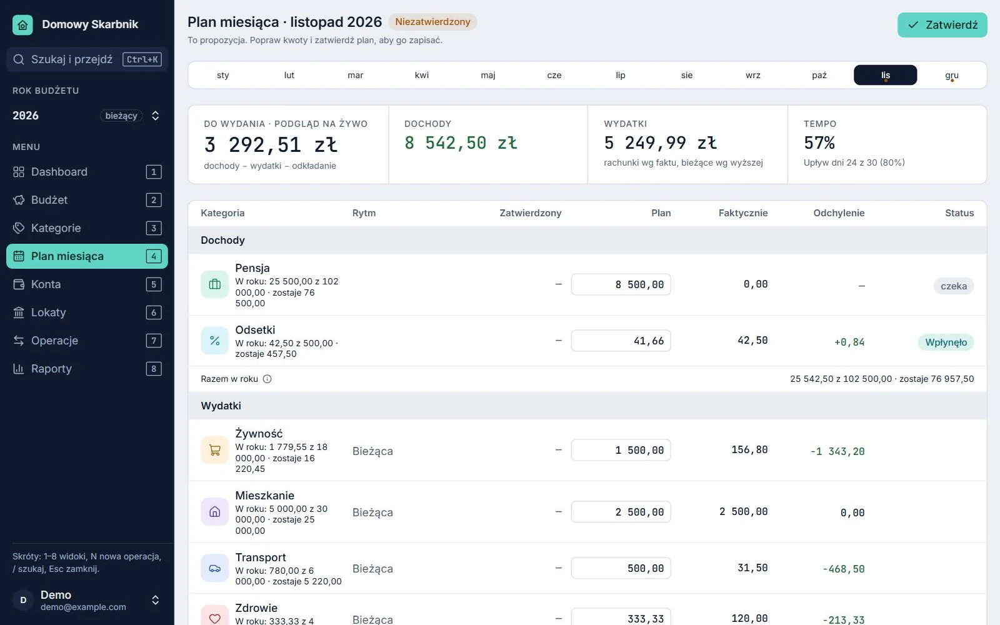
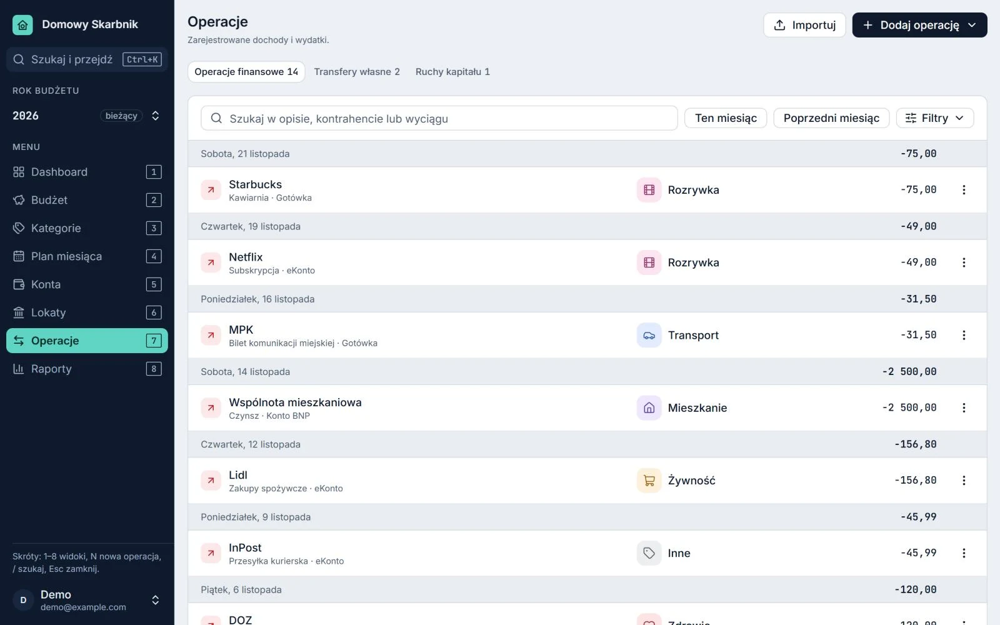

<div align="center">

# Domowy Skarbnik

**Household Treasurer — a yearly household budget with plan vs actual, liquidity across accounts and term deposits, and bank statement import.**

[](https://budget.kostecki.dev)
[](../../releases/latest)
[](../../actions/workflows/tests.yml)
[](CHANGELOG.md)

[](https://www.php.net/)
[](https://laravel.com/)
[](https://inertiajs.com/)
[](https://vuejs.org/)
[](https://www.typescriptlang.org/)
[](https://tailwindcss.com/)
[](https://www.postgresql.org/)
[](#mcp-server-for-claude)

[Live app](https://budget.kostecki.dev) · [Changelog](CHANGELOG.md) · [Operations runbook](context/foundation/operations.md) · [Report a bug](../../issues/new)

**English** · [Polski](README.pl.md)

</div>

<p align="center">
  
</p>

## About

Domowy Skarbnik helps one person prepare a yearly household budget, record how it is carried out and keep an eye on the money in bank accounts, cash and term deposits. It works on two planes:

- **Budget** — the Initial Plan, the Current Plan and Execution. Every expense category has a _Rhythm_: a fixed charge, a running category, an even annual one or an irregular one (a monthly rate plus "collected", which the bill uses up).
- **Liquidity** — _Spendable Liquidity_ (account and cash balances) and _Total funds_ (those balances plus term deposits), kept apart from the budget, because a category limit is not money in the bank.

The interface is in Polish and the currency is PLN. Accounts are created by an administrator; there is no self-registration, and every user sees only their own data.

## Features

- **Yearly budget** — income and expense categories for a calendar year, an Initial Plan frozen when execution starts and a Current Plan you keep adjusting.
- **Month Plan** — what is left in the current month for fixed charges and running categories, separate from the yearly limit, with category groups.
- **Accounts, cash and term deposits** — Spendable Liquidity and Total funds next to the budget, not mixed into it.
- **Operations** — expenses, income, refunds, own transfers between accounts and capital movements into term deposits, with a "before → after" preview in every dialog.
- **Bank statement import** — CSV and XLSX from mBank and BNP Paribas, duplicate detection, own-transfer pairing and category suggestions learned from your history.
- **Reports** — year, month, last 12 months and trend, compared with the previous year.
- **Year turn** — a December draft of next year, warnings on the dashboard and an import that refuses rows from a year whose budget is not running.
- **MCP server for Claude** — read your budget from Claude Code, Claude Desktop or claude.ai and, when enabled, record cash operations after you approve them.
- **Privacy and access** — e-mail verification, 2FA and passkeys; money is stored as integers in grosze, never as floats.

<table>
  <tr>
    <td></td>
    <td></td>
  </tr>
  <tr>
    <td align="center"><sub>Month Plan</sub></td>
    <td align="center"><sub>Operations</sub></td>
  </tr>
</table>

<sub>Screenshots use the demo household from <code>demo:seed-household</code>.</sub>

## Tech stack

| Layer | Technology |
| --- | --- |
| Backend | PHP 8.5 (code stays compatible with 8.4.1), Laravel 13, Fortify, Passport (OAuth for MCP), Laravel MCP |
| Frontend | Vue 3, TypeScript, Inertia 3, Tailwind CSS 4, shadcn-vue, Wayfinder, Vite+ (`vp`) |
| Database | PostgreSQL in CI and production; SQLite only as the default for quick local tests |
| Quality | Pest 5, Larastan, Laravel Pint, [Sloppy](https://github.com/heyosseus/sloppy), Vitest, Playwright E2E gates |
| Operations | Docker Compose on a VPS behind Traefik, Spatie Laravel Backup, self-hosted Bugsink for errors |

Decisions behind the stack: [`context/foundation/tech-stack.md`](context/foundation/tech-stack.md) and the [ADRs](context/foundation/adr/).

## Getting started

### Prerequisites

- Docker ([Laravel Sail](https://laravel.com/docs/sail); development runs on WSL2)
- Git

PHP and Composer on the host are optional if you install the dependencies through the Sail image.

### Installation

```bash
cp .env.example .env
```

With PHP and Composer on the host:

```bash
composer install
./vendor/bin/sail up -d
./vendor/bin/sail artisan key:generate
./vendor/bin/sail artisan migrate
./vendor/bin/sail npm install
```

Without PHP on the host, install the dependencies first:

```bash
docker run --rm \
    -u "$(id -u):$(id -g)" \
    -v "$(pwd):/var/www/html" \
    -w /var/www/html \
    laravelsail/php85-composer:latest \
    composer install --ignore-platform-reqs
```

Then `./vendor/bin/sail up -d` and the other `sail` commands above.

The app runs on <http://localhost> (`APP_PORT`, 80 by default), Mailpit on <http://localhost:8025>. For development with HMR:

```bash
./vendor/bin/sail composer run dev
```

If the UI does not refresh after a frontend change, keep that process running or build the assets with `./vendor/bin/sail npm run build`.

### First user and demo data

```bash
./vendor/bin/sail artisan user:create "Name" you@example.com --password=secret
./vendor/bin/sail artisan demo:seed-household you@example.com
```

The e-mail is verified straight away (`--unverified` leaves it for later). When the user already has domain data, add `--fresh` to `demo:seed-household` (and `--force` to skip the confirmation).

Optionally, after `demo:seed-household`, a previous-year budget for year-over-year comparisons:

```bash
./vendor/bin/sail artisan demo:seed-previous-year you@example.com
```

It runs only in `local` and `testing`. The previous year's amounts are derived from the current year's operations (a fixed 85–115% per category), not real data, and account balances do not change. `--remove` (with `--force` to skip the confirmation) deletes that budget. The `household_treasurer_e2e` database gets the mock once, with the same command.

## Testing and quality

```bash
./vendor/bin/sail artisan test --compact
./vendor/bin/sail bin/pint --dirty --format agent
./vendor/bin/sail composer types:check
./vendor/bin/sail npm run types:check
./vendor/bin/sail bin/sloppy ci
```

The full local gate is `./vendor/bin/sail composer ci:check`. `phpunit.xml` defaults to SQLite, while CI and production run PostgreSQL, so tests that touch migrations, raw SQL, dates, JSON or constraints must run on PostgreSQL (see [`AGENTS.md`](AGENTS.md)).

CI also runs [Sloppy](https://github.com/heyosseus/sloppy) (`vendor/bin/sloppy ci`) as a separate step: on a pull request it reports only findings introduced by the change, on a push it scans the whole project. Existing debt lives in `.sloppy-baseline.json`; refresh it (`vendor/bin/sloppy baseline`) only on purpose, never to silence a new finding.

## Admin commands

| Command | What it does |
| --- | --- |
| `user:create` | Creates a login account |
| `user:backup {user}` | JSON snapshot of the user's domain data (version 13) |
| `user:restore {user} {path}` | Restores a snapshot onto an existing user |
| `user:reset-data {user}` | Clears the domain data; the login account stays |
| `demo:seed-household {user}` | Demo data |
| `demo:seed-previous-year {user}` | Previous-year mock derived from the current year (local only; `--remove` deletes it) |
| `backup:restore {path}` | Restores a whole-instance (Spatie) backup, not `user:restore`; see [Wdrożenie i przywracanie](context/foundation/operations.md#wdrożenie-i-przywracanie) |
| `app:control-numbers` | Control numbers (`--output` saves, `--compare` compares); see [Liczby kontrolne](context/foundation/operations.md#liczby-kontrolne) |
| `app:rehearsal-clock {moment?}` | Rehearsal clock (local only): sets the app's "today"; `--off` turns it off; see [Przełom roku](context/foundation/operations.md#przełom-roku) |
| `budget:load-sheet {user} {path}` | Loads a year from the old spreadsheet (`--dry-run` previews); see [Wczytanie arkusza](context/foundation/operations.md#wczytanie-arkusza-lata-20192025) |
| `budget:unload-sheet {user} {year}` | Removes a loaded year; see [Wczytanie arkusza](context/foundation/operations.md#wczytanie-arkusza-lata-20192025) |
| `import:suggestion-accuracy {user}` | Accuracy of import suggestions (read-only); see [Pomiar trafności podpowiedzi Importu](context/foundation/operations.md#pomiar-trafności-podpowiedzi-importu) |

`{user}` is an e-mail address or an ID. Snapshots land in `storage/app/private/user-snapshots/`.

## MCP server for Claude

**Production.** `https://budget.kostecki.dev/mcp` works as a claude.ai custom connector on the web, in Claude Desktop and on the phone. It uses Passport OAuth with the normal login (2FA and passkeys included) and a Polish consent page. Six read tools cover account balances, To Spend, the Month Plan, the year plan vs Execution, recent operations and the category list. With `MCP_WRITE_ENABLED=true` Claude can also record a cash expense, refund or income after you approve the call.

**Local (stdio).** The `treasurer` server lets Claude Code and Claude Desktop query the local database. It works only with `APP_ENV=local` and reads the data of the one user named in `MCP_LOCAL_USER` (e-mail or ID):

```bash
MCP_LOCAL_USER=you@example.com
```

Add it to Claude Code through Sail (`-T` keeps stdio clean; `<dir>` is the main checkout with a running Sail stack):

```bash
claude mcp add treasurer --scope local -- docker compose -f <dir>/compose.yaml exec -T -u sail laravel.test php artisan mcp:start treasurer
```

Without Sail, `php artisan mcp:start treasurer` on the host needs `DB_HOST=127.0.0.1`, `DB_PORT=5434` (`FORWARD_DB_PORT`) and PHP 8.4.1. To ask about production data, restore a snapshot (`user:restore`) onto a local user and point `MCP_LOCAL_USER` at it.

## Deployment

Production runs on its own Docker Compose stack on a VPS: the app, PostgreSQL, Traefik as the reverse proxy and a queue worker. Every deployment snapshots each user, records control numbers, takes a full instance backup before `migrate` and keeps tagged images for a rollback without a rebuild.

The full runbook (in Polish) — deployment steps, rollback, restore, migration rehearsals and the year turn — lives in [`context/foundation/operations.md`](context/foundation/operations.md).

## Documentation

The project follows the 10x convention: `context/foundation/` holds living documents, `context/changes/` the changes in progress and `context/archive/` the closed ones.

| Document | What it is for |
| --- | --- |
| [`glossary.md`](context/foundation/glossary.md) | Domain glossary (the language of the code and the agents) |
| [`prd-mvp.md`](context/foundation/prd-mvp.md), [`mvp.md`](context/foundation/mvp.md) | Product requirements and the short MVP scope |
| [`prd.md`](context/foundation/prd.md), `prd-v2.md` | PRDs of later changes (month plan, reports) |
| [`roadmap.md`](context/foundation/roadmap.md) | Roadmap |
| [`tech-stack.md`](context/foundation/tech-stack.md) | Technology decisions |
| [`adr/`](context/foundation/adr/) | Architecture decision records |
| [`design-system.md`](context/foundation/design-system.md) | Design system (Atrament): tokens, surfaces, typography |
| [`test-plan.md`](context/foundation/test-plan.md) | Test plan |
| [`operations.md`](context/foundation/operations.md) | Production runbook |
| [`AGENTS.md`](AGENTS.md) | Rules for AI agents; `.ai/rules/` holds per-path rules |

The glossary is the source of names: avoid the synonyms it rules out.

## Project status

Version **1.6.0** runs in production at [budget.kostecki.dev](https://budget.kostecki.dev). Changes are listed in [`CHANGELOG.md`](CHANGELOG.md); every version is a tag on `main` and a GitHub release.

## License

No open-source license has been chosen yet, so all rights are reserved © Sebastian Kostecki. You are welcome to read the code; ask before reusing it.
