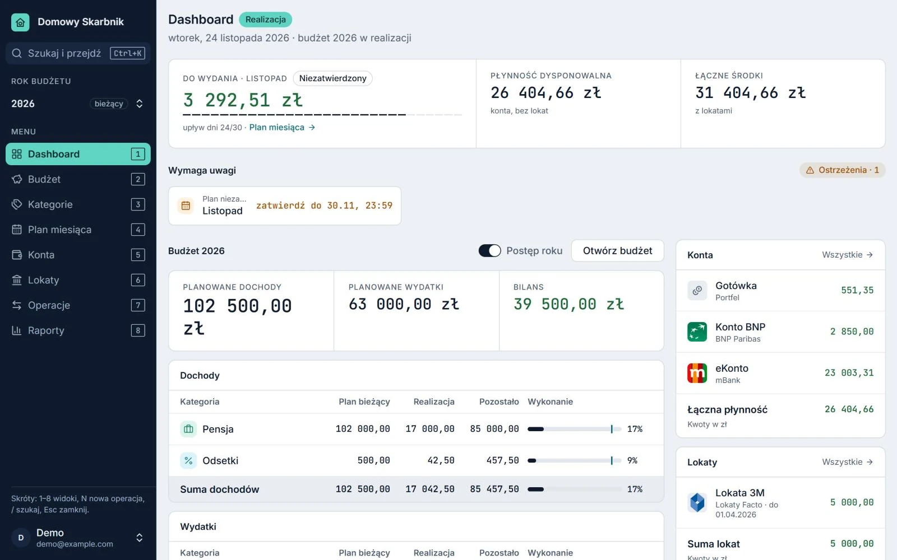
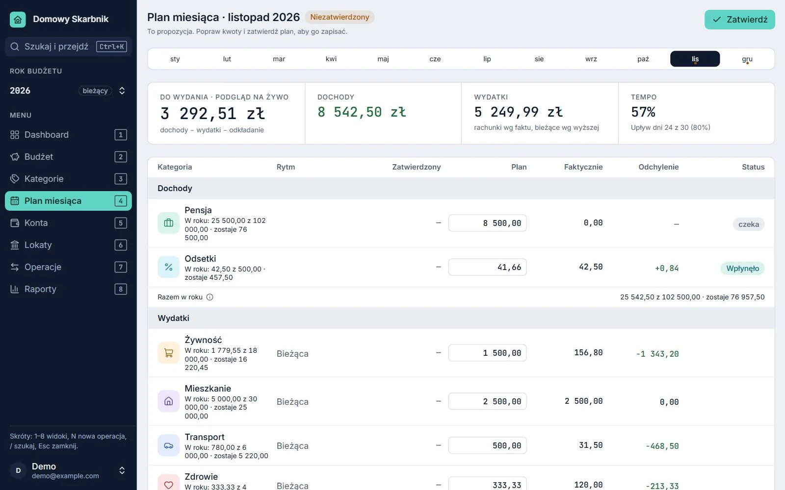
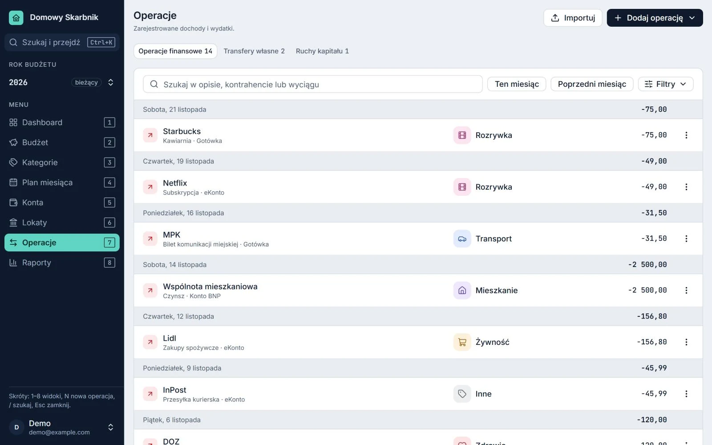

<div align="center">

# Domowy Skarbnik

**Roczny budżet domowy: plan kontra wykonanie, płynność na kontach i lokatach oraz import wyciągów bankowych.**

[](https://budget.kostecki.dev)
[](../../releases/latest)
[](../../actions/workflows/tests.yml)
[](CHANGELOG.md)

[](https://www.php.net/)
[](https://laravel.com/)
[](https://inertiajs.com/)
[](https://vuejs.org/)
[](https://www.typescriptlang.org/)
[](https://tailwindcss.com/)
[](https://www.postgresql.org/)
[](#serwer-mcp-dla-claude)

[Aplikacja](https://budget.kostecki.dev) · [Changelog](CHANGELOG.md) · [Runbook produkcji](context/foundation/operations.md) · [Zgłoś błąd](../../issues/new)

[English](README.md) · **Polski**

</div>

<p align="center">
  
</p>

## O projekcie

Domowy Skarbnik pomaga jednej osobie przygotować roczny budżet domowy, rejestrować jego wykonanie i pilnować pieniędzy na rachunkach, w gotówce i na lokatach. Działa na dwóch płaszczyznach:

- **Budżet** — plan początkowy, plan aktualny i wykonanie. Każda kategoria wydatkowa ma rytm (_Rhythm_): stała opłata, bieżąca, równomierna roczna albo nieregularna (stawka miesięczna i „zebrane”, które zużywa rachunek).
- **Płynność** — _Spendable Liquidity_ (salda kont i gotówki) i _Total funds_ (te salda plus lokaty), osobno od budżetu, bo limit kategorii to nie pieniądze na koncie.

Interfejs jest po polsku, waluta to PLN. Konta logowania tworzy administrator; samodzielnej rejestracji nie ma, a każdy użytkownik widzi wyłącznie własne dane.

## Funkcje

- **Budżet roczny** — kategorie dochodów i wydatków na rok kalendarzowy, plan początkowy zamrażany przy starcie realizacji i plan bieżący, który korygujesz na bieżąco.
- **Plan miesiąca** — ile zostało w bieżącym miesiącu na stałe opłaty i kategorie bieżące, osobno od limitu rocznego, z grupami kategorii.
- **Konta, gotówka i lokaty** — płynność dysponowalna i łączne środki obok budżetu, a nie w nim.
- **Operacje** — wydatki, dochody, zwroty, transfery własne między kontami i ruchy kapitału do lokat, z podglądem „przed → po” w każdym oknie.
- **Import wyciągów** — CSV i XLSX z mBanku i BNP Paribas, wykrywanie duplikatów, parowanie transferów własnych i podpowiedzi kategorii uczone na Twojej historii.
- **Raporty** — rok, miesiąc, ostatnie 12 miesięcy i trend, w porównaniu z poprzednim rokiem.
- **Przełom roku** — szkic przyszłego roku w grudniu, ostrzeżenia na dashboardzie i import, który nie przyjmie wierszy z roku bez budżetu w realizacji.
- **Serwer MCP dla Claude** — odczyt budżetu z Claude Code, Claude Desktop albo claude.ai, a po włączeniu także zapis operacji gotówkowych po Twojej akceptacji.
- **Prywatność i dostęp** — weryfikacja e-mail, 2FA i klucze dostępu; kwoty trzymane są jako liczby całkowite w groszach, nigdy jako float.

<table>
  <tr>
    <td></td>
    <td></td>
  </tr>
  <tr>
    <td align="center"><sub>Plan miesiąca</sub></td>
    <td align="center"><sub>Operacje</sub></td>
  </tr>
</table>

<sub>Zrzuty pokazują gospodarstwo demo z <code>demo:seed-household</code>.</sub>

## Stos technologiczny

| Warstwa | Technologia |
| --- | --- |
| Backend | PHP 8.5 (kod zgodny z 8.4.1), Laravel 13, Fortify, Passport (OAuth dla MCP), Laravel MCP |
| Frontend | Vue 3, TypeScript, Inertia 3, Tailwind CSS 4, shadcn-vue, Wayfinder, Vite+ (`vp`) |
| Baza danych | PostgreSQL w CI i na produkcji; SQLite tylko jako domyślna baza szybkich testów lokalnych |
| Jakość | Pest 5, Larastan, Laravel Pint, [Sloppy](https://github.com/heyosseus/sloppy), Vitest, bramki E2E Playwright |
| Utrzymanie | Docker Compose na VPS za Traefikiem, Spatie Laravel Backup, własny Bugsink do błędów |

Decyzje stojące za stosem: [`context/foundation/tech-stack.md`](context/foundation/tech-stack.md) i [ADR-y](context/foundation/adr/).

## Uruchomienie

### Wymagania lokalne

- Docker (środowisko deweloperskie to [Laravel Sail](https://laravel.com/docs/sail) na WSL2)
- Git

PHP i Composer na hoście nie są potrzebne, jeśli Sail instalujesz przez obraz Dockera.

### Instalacja

```bash
cp .env.example .env
```

Z PHP i Composerem na hoście:

```bash
composer install
./vendor/bin/sail up -d
./vendor/bin/sail artisan key:generate
./vendor/bin/sail artisan migrate
./vendor/bin/sail npm install
```

Bez PHP na hoście — najpierw zaciągnij zależności:

```bash
docker run --rm \
    -u "$(id -u):$(id -g)" \
    -v "$(pwd):/var/www/html" \
    -w /var/www/html \
    laravelsail/php85-composer:latest \
    composer install --ignore-platform-reqs
```

Dalej `./vendor/bin/sail up -d` i pozostałe komendy `sail` jak wyżej.

Aplikacja: <http://localhost> (port `APP_PORT`, domyślnie 80). Mailpit: <http://localhost:8025>. Dev z HMR:

```bash
./vendor/bin/sail composer run dev
```

Jeśli UI nie odświeża się po zmianie frontendu, zostaw ten proces albo zbuduj assety: `./vendor/bin/sail npm run build`.

### Pierwszy użytkownik i dane demo

```bash
./vendor/bin/sail artisan user:create "Imię" you@example.com --password=secret
./vendor/bin/sail artisan demo:seed-household you@example.com
```

Domyślnie e-mail jest od razu zweryfikowany. `--unverified` zostawia potwierdzenie na później. Gdy użytkownik ma już dane domenowe, dodaj do `demo:seed-household` opcję `--fresh` (i `--force`, żeby pominąć potwierdzenie).

Opcjonalnie, po `demo:seed-household`: budżet roku poprzedniego do porównań rok do roku.

```bash
./vendor/bin/sail artisan demo:seed-previous-year you@example.com
```

Polecenie działa tylko w środowiskach `local` i `testing`. Kwoty roku poprzedniego są pochodną operacji bieżącego roku (stały procent 85-115 na kategorię), nie prawdziwymi danymi; salda kont się nie zmieniają. `--remove` (z `--force` bez potwierdzenia) usuwa taki budżet. Baza `household_treasurer_e2e` dostaje mock raz, tym samym poleceniem.

## Testy i jakość

```bash
./vendor/bin/sail artisan test --compact
./vendor/bin/sail bin/pint --dirty --format agent
./vendor/bin/sail composer types:check
./vendor/bin/sail npm run types:check
./vendor/bin/sail bin/sloppy ci
```

Pełny zestaw lokalny: `./vendor/bin/sail composer ci:check`. `phpunit.xml` domyślnie używa SQLite, a CI i produkcja PostgreSQL, więc testy migracji, surowego SQL, dat, JSON-a i ograniczeń uruchamiaj na PostgreSQL (zob. [`AGENTS.md`](AGENTS.md)).

CI uruchamia dodatkowo [Sloppy](https://github.com/heyosseus/sloppy) (`vendor/bin/sloppy ci`) jako osobny krok: w PR zgłasza tylko znaleziska wprowadzone przez zmianę, na pushu skanuje cały projekt. Istniejący dług jest w `.sloppy-baseline.json`; odświeżaj go (`vendor/bin/sloppy baseline`) tylko świadomie, nie żeby uciszyć nowe znalezisko.

## Komendy administracyjne

| Komenda | Działanie |
| --- | --- |
| `user:create` | Konto logowania |
| `user:backup {user}` | Snapshot JSON danych domenowych (wersja 13) |
| `user:restore {user} {path}` | Przywrócenie snapshotu na istniejącego użytkownika |
| `user:reset-data {user}` | Wyczyszczenie danych domenowych, konto logowania zostaje |
| `demo:seed-household {user}` | Dane demo |
| `demo:seed-previous-year {user}` | Mock roku poprzedniego z bieżącego (tylko lokalnie; `--remove` usuwa) |
| `backup:restore {path}` | Restore backupu całej instancji (Spatie), nie `user:restore`; zob. [Wdrożenie i przywracanie](context/foundation/operations.md#wdrożenie-i-przywracanie) |
| `app:control-numbers` | Liczby kontrolne (zapis `--output`, porównanie `--compare`); zob. [Liczby kontrolne](context/foundation/operations.md#liczby-kontrolne) |
| `app:rehearsal-clock {moment?}` | Zegar próby (tylko lokalnie): ustawia „dziś” aplikacji; `--off` wyłącza; zob. [Przełom roku](context/foundation/operations.md#przełom-roku) |
| `budget:load-sheet {user} {path}` | Wczytanie roku ze starego arkusza (`--dry-run` tylko podgląd); zob. [Wczytanie arkusza](context/foundation/operations.md#wczytanie-arkusza-lata-20192025) |
| `budget:unload-sheet {user} {year}` | Wycofanie wczytanego roku; zob. [Wczytanie arkusza](context/foundation/operations.md#wczytanie-arkusza-lata-20192025) |
| `import:suggestion-accuracy {user}` | Trafność podpowiedzi Importu (tylko odczyt); zob. [Pomiar trafności podpowiedzi Importu](context/foundation/operations.md#pomiar-trafności-podpowiedzi-importu) |

`{user}` to e-mail albo ID. Snapshoty lądują w `storage/app/private/user-snapshots/`.

## Serwer MCP dla Claude

**Produkcja.** `https://budget.kostecki.dev/mcp` działa jako własny konektor claude.ai w przeglądarce, w Claude Desktop i w telefonie: Passport OAuth, zwykłe logowanie (z 2FA i kluczem dostępu) i polska strona zgody. Sześć narzędzi odczytu obejmuje salda kont, „do wydania”, plan miesiąca, plan roku kontra wykonanie, ostatnie operacje i listę kategorii. Z `MCP_WRITE_ENABLED=true` Claude może też zapisać wydatek, zwrot albo dochód gotówkowy po Twojej akceptacji.

**Lokalnie (stdio).** Serwer `treasurer` (ADR-0110) pozwala Claude Code i Claude Desktop pytać o budżet z lokalnej bazy. Działa tylko w `APP_ENV=local` i czyta dane jednego użytkownika, którego wskazuje `MCP_LOCAL_USER` (e-mail albo ID) w `.env`:

```bash
MCP_LOCAL_USER=ty@example.com
```

Dodanie do Claude Code przez Sail (`-T` zostawia stdio w spokoju; `<katalog>` to główny checkout z działającym stosem Sail):

```bash
claude mcp add treasurer --scope local -- docker compose -f <katalog>/compose.yaml exec -T -u sail laravel.test php artisan mcp:start treasurer
```

Bez Sail: `php artisan mcp:start treasurer` z hosta wymaga `DB_HOST=127.0.0.1` i `DB_PORT=5434` (`FORWARD_DB_PORT`) oraz PHP 8.4.1, bo host nie rozwiąże `DB_HOST=pgsql`. Żeby pytać o dane produkcyjne, przywróć snapshot (`user:restore`) na lokalnego użytkownika i wskaż go w `MCP_LOCAL_USER`. Bez ustawionego użytkownika albo poza środowiskiem `local` serwer odmawia startu.

## Produkcja

Własny Docker Compose na VPS: aplikacja, PostgreSQL, Traefik jako reverse proxy i worker kolejki. Każde wdrożenie robi snapshot każdego użytkownika, liczby kontrolne i pełną kopię instancji przed `migrate`, a obrazy z tagami pozwalają wycofać wersję bez budowania.

Pełny runbook — kroki wdrożenia, wycofanie, przywracanie, próby migracji i przełom roku — jest w [`context/foundation/operations.md`](context/foundation/operations.md).

## Dokumentacja

Dokumentacja projektu leży w `context/` według konwencji 10x: `foundation/` to dokumenty żyjące ponad zmianami, `changes/` to zmiany w toku, `archive/` to zmiany zamknięte.

| Dokument | Po co |
| --- | --- |
| [`glossary.md`](context/foundation/glossary.md) | Słownik domeny (język kodu i agentów) |
| [`prd-mvp.md`](context/foundation/prd-mvp.md), [`mvp.md`](context/foundation/mvp.md) | Wymagania produktu (MVP) i krótki zakres |
| [`prd.md`](context/foundation/prd.md), `prd-v2.md` | PRD kolejnych zmian (plan miesiąca, raporty) |
| [`roadmap.md`](context/foundation/roadmap.md) | Mapa drogowa |
| [`tech-stack.md`](context/foundation/tech-stack.md) | Decyzje technologiczne |
| [`adr/`](context/foundation/adr/) | Decyzje architektoniczne |
| [`design-system.md`](context/foundation/design-system.md) | Design system (Atrament): tokeny, powierzchnie, typografia |
| [`test-plan.md`](context/foundation/test-plan.md) | Plan testów |
| [`operations.md`](context/foundation/operations.md) | Runbook produkcji |
| [`AGENTS.md`](AGENTS.md) | Zasady pracy dla agentów AI; `.ai/rules/` ma reguły per ścieżka |

Słownik jest źródłem nazw. Unikaj synonimów, które ten plik wyklucza.

## Status projektu

Wersja **1.6.0** działa na produkcji pod [budget.kostecki.dev](https://budget.kostecki.dev). Zmiany opisuje [`CHANGELOG.md`](CHANGELOG.md); każda wersja to tag na `main` i release na GitHubie.

## Licencja

Projekt nie ma jeszcze licencji open source, więc wszelkie prawa są zastrzeżone © Sebastian Kostecki. Kod można czytać; przed ponownym użyciem zapytaj.
